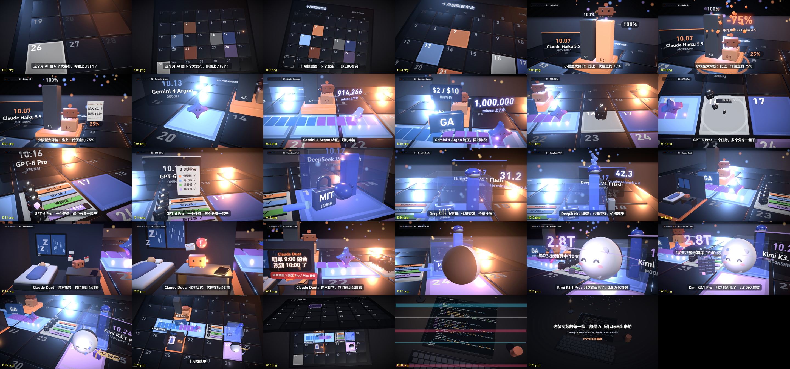

# 十月模型发布会 · AI 写代码做的 3D 动画

一条 63 秒的 3D 动画，盘点 2026 年 10 月的 6 个 AI 模型发布。画面、镜头和配乐全部由代码生成：Three.js（React Three Fiber）+ Remotion 出画面，Python 合成配乐。没有用视频生成模型，也没有用素材库。代码由 Claude Opus 5.5 编写。

https://github.com/user-attachments/assets/03b5d2ae-8324-4675-b2eb-23530d15e7eb



- **想直接出片**：按下面的「运行」做。
- **想让自己的 AI 从零做一条**：看 [提示词.md](提示词.md)，2 条提示词。
- **分镜**：[docs/分镜.md](docs/分镜.md)

## 运行

需要 Node.js 18+、Python 3.10+（numpy、scipy、soundfile）、ffmpeg。

```bash
npm ci
npm run studio      # 浏览器里预览、拖时间轴
npm run score       # 合成配乐 → out/score.wav
npm run render      # 渲染画面 → out/video.mp4，核显约 1 秒/帧，整片约半小时
npm run mux         # 合成成片 → out/final.mp4
```

## 结构

全片按 125 BPM 排拍（一拍 14.4 帧，一小节 57.6 帧），33 小节：钩子 2 → 开场 2 → 6 幕各 4 → 结尾 5（成绩单 → 翻到 11 月 → 屏幕变代码、拉远露出桌面 → 落款）。

| 文件 | 内容 |
| --- | --- |
| `src/v4/timing.ts` | 节拍和各段起始帧 |
| `src/v4/SceneV4.tsx` | 镜头路径、灯光、雾、后期，挂载各幕 |
| `src/v4/calendar.tsx` | 平板和日历 |
| `src/v4/haiku.tsx` … `kimi.tsx` | 6 幕，每幕一个文件 |
| `src/v4/endcard.tsx` | 11 月翻页、代码屏、桌面 |
| `src/v4/OverlayV4.tsx` | 字幕、进度标签、落款卡 |
| `src/Characters.tsx` | 5 个角色，全部几何体自建 |
| `src/anim.ts`、`cam.ts`、`common.tsx` | 缓动、样条镜头、Label 等共用部件 |
| `audio/score_v5_drive.py` | 成片配乐（house 律动层），依赖 `score_v5.py`（铺底和画面音效）、`score_v4.py`、`mix_v4.py`（基础音色） |

`src/v4` 的命名沿用制作时的版本号：v5 是在 v4 一镜到底的基础上加长的，每幕旧的 3 小节动画用 `warp()` 换算成旧本地帧 `L`，新增的「第二拍」和环境动画用新本地帧 `Ln`。

## 说明

- 片中各模型的发布信息是 2026-10-26 按第三方报道整理的，未逐条核对官方原文。
- 角色是参考各家形象用几何体自建的示意造型，不是官方素材；各公司名称和商标归各自所有。
- 代码采用 [MIT](LICENSE) 许可。
